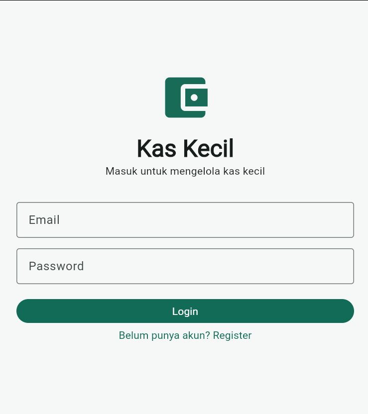
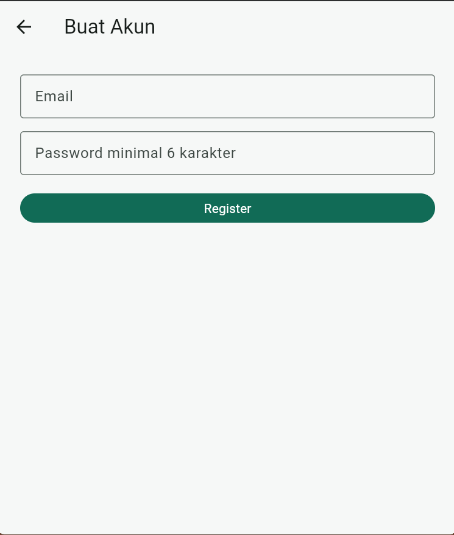
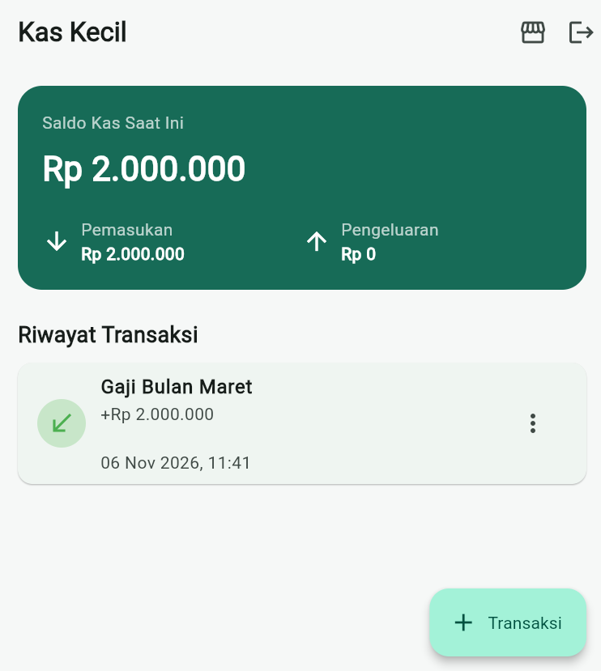
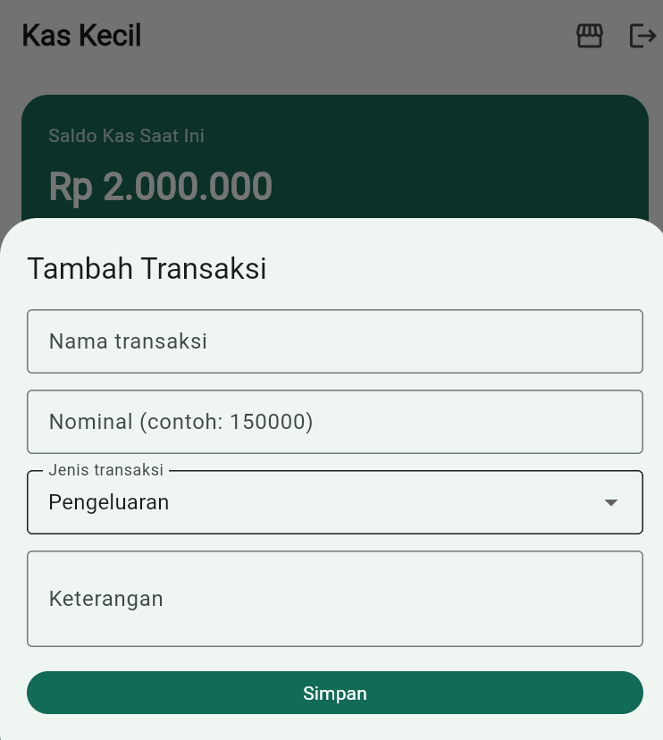
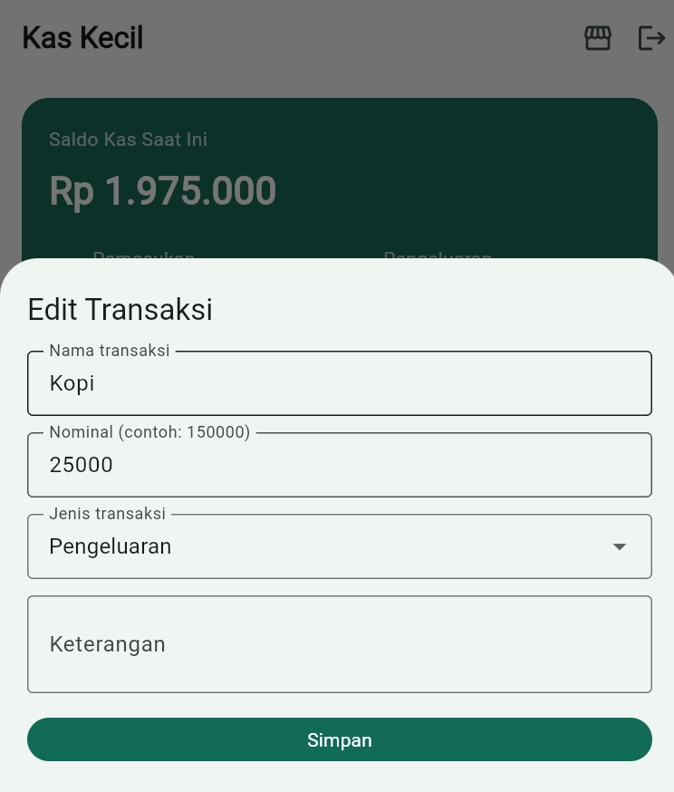
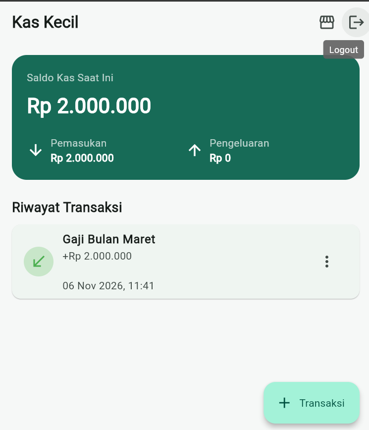

# 💰 APLIKASI KAS KECIL

<p align="center">
  **Ujian Tengah Semester (UTS) – Pemrograman Multi Platform**  
  Fakultas Teknologi Informasi  
  Institut Sains dan Bisnis Atma Luhur Pangkalpinang  
  Program Studi Teknologi Informasi  
  Tahun Akademik 2026/2027
</p>

---

## 📖 Deskripsi Aplikasi

**Kas Kecil** merupakan aplikasi mobile berbasis Flutter yang digunakan untuk mencatat dan mengelola transaksi keuangan, khususnya pemasukan dan pengeluaran.

Aplikasi ini dikembangkan dengan mengintegrasikan Firebase Authentication, Cloud Firestore, Provider, serta REST API menggunakan Dio. Selain mengelola transaksi keuangan, aplikasi juga menyediakan halaman referensi produk yang mengambil data dari DummyJSON API.

## 👥 Anggota Kelompok

| No. | Nama Mahasiswa | NIM |
|:---:|---|:---:|
| 1 | Zena Juniarti | 2411500046 |
| 2 | Zahro Safitri | 2411500063 |

## 📋 Pembagian Tugas Anggota

### Anggota 1 — Authentication, Navigasi, dan Struktur Aplikasi

| No. | Tugas | Deskripsi |
|:---:|---|---|
| 1 | Struktur aplikasi | Menyiapkan struktur folder dan konfigurasi awal aplikasi. |
| 2 | Firebase | Menginisialisasi Firebase melalui `main.dart` dan `firebase_options.dart`. |
| 3 | Authentication | Mengimplementasikan Register, Login, dan Logout. |
| 4 | AuthService | Mengelola proses autentikasi menggunakan Firebase Authentication. |
| 5 | AuthProvider | Mengelola status autentikasi menggunakan ChangeNotifier. |
| 6 | Auth State | Memantau perubahan status login menggunakan `authStateChanges()`. |
| 7 | Navigasi | Mengatur AuthGate dan navigasi berdasarkan status login pengguna. |

### Anggota 2 — Firestore CRUD, Provider, dan REST API

| No. | Tugas | Deskripsi |
|:---:|---|---|
| 1 | Model | Membuat `TransactionModel` dan `ProductModel`. |
| 2 | FirestoreService | Mengimplementasikan operasi Create, Read, Update, dan Delete transaksi. |
| 3 | TransactionProvider | Mengelola data transaksi, pemasukan, pengeluaran, dan saldo. |
| 4 | ViewState | Mengelola status loading, loaded, error, dan empty. |
| 5 | ApiService | Mengambil data produk dari REST API DummyJSON menggunakan Dio. |
| 6 | ApiProvider | Mengelola data produk dan status pemuatan API. |
| 7 | Future dan Stream | Menerapkan proses asynchronous menggunakan Future dan Stream. |

**Catatan:** Karena kelompok terdiri dari dua orang, Anggota 2 juga menangani integrasi Dio REST API, penanganan loading/error/empty, serta penerapan Future dan Stream.

---

## 🚀 Fitur Aplikasi

### 1. Firebase Authentication

- Registrasi akun menggunakan email dan password.
- Login dan Logout pengguna.
- Memantau status autentikasi secara reaktif menggunakan `Stream<User?>`.
- Menggunakan `authStateChanges()` untuk mengetahui perubahan status login.
- Mengarahkan pengguna ke halaman Login atau Home berdasarkan status autentikasi.

### 2. Cloud Firestore CRUD

- Menyimpan data transaksi pada collection `transactions`.
- Mendukung operasi Create, Read, Update, dan Delete.
- Menggunakan `owner` berupa UID pengguna untuk mengaitkan transaksi dengan pemiliknya.
- Menggunakan `Timestamp` untuk menyimpan waktu transaksi.
- Memantau perubahan data transaksi secara real-time menggunakan `snapshots()`.

### 3. Provider dan ViewState

- Menggunakan tiga `ChangeNotifier`, yaitu:
  - `AuthProvider`
  - `TransactionProvider`
  - `ApiProvider`
- Mendaftarkan seluruh Provider menggunakan `MultiProvider` pada `main.dart`.
- Menggunakan `ViewState` untuk mengelola kondisi tampilan:
  - `loading`
  - `loaded`
  - `error`
  - `empty`
- Menggunakan `notifyListeners()` untuk memperbarui tampilan ketika state berubah.
- Membatalkan subscription Stream ketika Provider tidak lagi digunakan.

### 4. REST API menggunakan Dio

- Mengambil data produk dari [DummyJSON API](https://dummyjson.com/products).
- Menggunakan Dio untuk melakukan HTTP GET request.
- Mengubah respons JSON menjadi objek `ProductModel`.
- Menampilkan indikator loading ketika data sedang diambil.
- Menampilkan pesan error dan menyediakan fitur mencoba kembali.
- Menangani kondisi ketika data kosong.
- Menampilkan daftar produk dan halaman detail produk.
- Mengonversi harga produk ke Rupiah menggunakan kurs simulasi Rp16.000 per USD.

### 5. Navigasi dan Halaman Aplikasi

Aplikasi memiliki enam halaman utama sebagai berikut:

| No. | Halaman | Nama File | Fungsi |
|:---:|---|---|---|
| 1 | Login | `login_screen.dart` | Autentikasi pengguna yang telah memiliki akun. |
| 2 | Register | `register_screen.dart` | Pendaftaran akun pengguna baru. |
| 3 | Home | `home_screen.dart` | Menampilkan saldo, pemasukan, pengeluaran, dan riwayat transaksi. |
| 4 | Form Transaksi | `transaction_form.dart` | Menambahkan atau mengubah transaksi. |
| 5 | Daftar Produk | `api_screen.dart` | Menampilkan produk dari REST API. |
| 6 | Detail Produk | `product_detail_screen.dart` | Menampilkan informasi detail produk yang dipilih. |

---

## 🛠️ Teknologi yang Digunakan

| Teknologi | Keterangan |
|---|---|
| Flutter | Framework untuk membangun aplikasi mobile. |
| Dart | Bahasa pemrograman yang digunakan dalam pengembangan aplikasi. |
| Firebase Authentication | Mengelola registrasi, login, dan logout pengguna. |
| Cloud Firestore | Menyimpan dan mengelola data transaksi. |
| Provider / MultiProvider | Mengelola state aplikasi. |
| Dio | Menghubungkan aplikasi dengan REST API. |
| DummyJSON | Menyediakan data produk melalui REST API. |
| Future | Menangani proses asynchronous dengan satu hasil penyelesaian. |
| Stream | Menangani aliran data dan pembaruan secara berkelanjutan. |

---

## 📸 Screenshot Aplikasi

Berikut merupakan dokumentasi tampilan antarmuka aplikasi Kas Kecil.

| **Halaman Login** | **Halaman Register** |
|:---:|:---:|
|  |  |

| **Halaman Home** | **Form Transaksi** |
|:---:|:---:|
|  |  |
|  |  |

> **Catatan:** Gambar di atas merupakan referensi nama file. Pastikan screenshot aktual sudah dimasukkan ke folder `screenshots` di repository GitHub.

---

## 💻 Cara Menjalankan Aplikasi

### 1. Prasyarat

Sebelum menjalankan aplikasi, pastikan perangkat telah memiliki:

- Flutter SDK.
- Dart SDK.
- Android Studio atau Visual Studio Code.
- Koneksi internet.
- Proyek Firebase.

### 2. Clone Repository

Jalankan perintah berikut pada terminal:

```bash
git clone https://github.com/senn-komi/UTS_KAS-KECIL.git
```

### 3. Masuk ke Folder Proyek

```bash
cd UTS_KAS-KECIL
```

### 4. Masuk ke Folder Aplikasi

```bash
cd keuangan
```

### 5. Install Dependencies

```bash
flutter pub get
```

### 6. Jalankan Aplikasi

```bash
flutter run
```

### 7. Periksa Kode Aplikasi

Untuk memeriksa kemungkinan kesalahan pada kode, jalankan:

```bash
flutter analyze
```

---

## 🔥 Konfigurasi Firebase

Aplikasi menggunakan Firebase Authentication dan Cloud Firestore. Pastikan konfigurasi Firebase telah tersedia sebelum menjalankan aplikasi.

### Konfigurasi Firebase

Jika ingin menghubungkan aplikasi dengan proyek Firebase sendiri, jalankan perintah berikut:

```bash
dart pub global activate flutterfire_cli
firebase login
flutterfire configure
```

### Pengaturan Firebase Console

Pastikan beberapa konfigurasi berikut sudah dilakukan:

1. Aktifkan metode autentikasi **Email/Password** pada Firebase Console bagian Authentication.
2. Buat dan konfigurasi database **Cloud Firestore**.
3. Pastikan aplikasi telah terhubung dengan proyek Firebase yang sesuai.

**Penting:** File `lib/firebase_options.dart` perlu disertakan dalam repository dan tidak boleh dimasukkan ke `.gitignore`, agar konfigurasi Firebase dapat digunakan ketika proyek dijalankan.

---

## 🔄 Penerapan Future dan Stream

Dalam aplikasi Kas Kecil, Future dan Stream digunakan untuk menangani proses asynchronous.

### 1. Future

Future merupakan mekanisme asynchronous yang menghasilkan satu hasil penyelesaian.

Dalam aplikasi ini, Future digunakan untuk:

- Mengambil data produk melalui Dio.
- Melakukan proses Login dan Register.
- Menjalankan operasi CRUD Firestore.
- Mengambil data transaksi satu kali melalui proses `loadOnce()`.

### 2. Stream

Stream merupakan mekanisme asynchronous yang memungkinkan aplikasi menerima data atau perubahan secara berkelanjutan.

Dalam aplikasi ini, Stream digunakan untuk:

- Memantau perubahan status autentikasi menggunakan `authStateChanges()`.
- Memantau perubahan data transaksi Firestore menggunakan `snapshots()`.

### 3. Perbedaan Future dan Stream

| Aspek | Future | Stream |
|---|---|---|
| Hasil | Satu hasil penyelesaian | Dapat menghasilkan banyak data |
| Proses | Sekali selesai | Berkelanjutan |
| Penggunaan | Pengambilan data satu kali | Pemantauan perubahan data |
| Contoh aplikasi | HTTP request Dio | Perubahan transaksi Firestore |

Dengan demikian, Future digunakan untuk proses yang cukup dilakukan satu kali, sedangkan Stream digunakan ketika aplikasi perlu terus menerima dan memantau pembaruan data.

---

## 🎥 Video Presentasi

Video presentasi ini berisi penjelasan mengenai proses pengembangan aplikasi, fitur-fitur utama, implementasi Firebase, Firestore CRUD, Provider, REST API Dio, serta penerapan Future dan Stream.

**Link Video:** [Tambahkan tautan video presentasi di sini]

---

## ℹ️ Informasi Repository

| Keterangan | Informasi |
|---|---|
| Nama Repository | `UTS_KAS-KECIL` |
| GitHub | [UTS_KAS-KECIL](https://github.com/senn-komi/UTS_KAS-KECIL) |
| Folder Project | `keuangan` |
| Mata Kuliah | Pemrograman Multi Platform |
| Fakultas | Fakultas Teknologi Informasi |
| Program Studi | Teknologi Informasi |
| Institusi | Institut Sains dan Bisnis Atma Luhur Pangkalpinang |
| Tahun Akademik | 2026/2027 |

---

<p align="center">
  **Dikembangkan untuk memenuhi Ujian Tengah Semester (UTS)**  
  Pemrograman Multi Platform  
  Institut Sains dan Bisnis Atma Luhur Pangkalpinang
</p>
